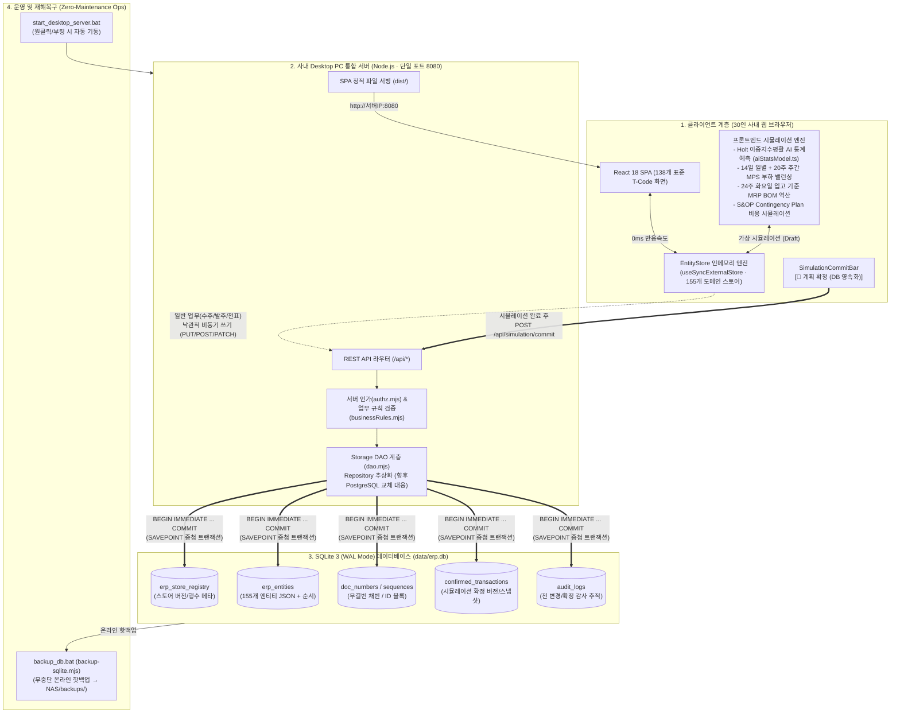

# AX 통합 비즈니스 플랫폼 아키텍처 설계서 v2.0

> 작성일: 2026-11-12 (v2.0 — Desktop PC SQLite WAL 서버 & 프론트엔드 EntityStore 시뮬레이션 확정 아키텍처 반영)
> 대상: 소비자용 소형가전 및 전자부품 제조 기업용 Standard ERP Portal (그린전자 혁신기획팀)

---

## 1. 아키텍처 핵심 설계 철학 (Dual-Engine Hybrid Architecture)

본 시스템은 **30명 규모의 제조 사업부가 고가의 상용 서버나 전담 DBA 없이도 즉시 엔터프라이즈급 ERP 및 AI SCM 계획 체계를 운영**할 수 있도록 다음과 같은 하이브리드 아키텍처로 설계·구축·운영된다.

> **핵심 아키텍처 정의**:
> "Desktop PC를 서버로 활용하는 **SQLite(WAL) DB**와 브라우저 기반 고속 트랜잭션을 처리하는 **EntityStore 인메모리 엔진**을 병행하여, 통계 모델(Holt 이중지수평활 등)과 생산/자재 계획을 **프론트엔드에서 고속 시뮬레이션한 뒤 Backend 및 DB에 확정(Commit) 값을 원자적으로 저장**하는 구조로 설계·구축·운영된다."



---

## 2. 이원화 데이터 처리 라이프사이클 (Two-Track Transaction Lifecycle)

업무 성격에 따라 데이터 저장 흐름을 **Track A (즉시 트랜잭션)**와 **Track B (시뮬레이션 후 확정 저장)**로 이원화하여, 사용자 체감 속도와 데이터 거버넌스(Audit)를 동시에 달성한다.

### Track A: 일상 트랜잭션 업무 (수주, 발주, 입출고, 회계전표, 마스터 관리)
1. **초기 부트스트랩 (`GET /api/snapshot`)**: 앱 진입 시 1회 호출로 SQLite DB의 전체 스토어 스냅샷을 `EntityStore` 인메모리로 하이드레이션(`hydrateFromBackend`)하고, ID 채번 구간(`POST /api/sequence/reserve`)을 사전 확보한다.
2. **낙관적 즉시 반영 (Optimistic Write)**: 사용자가 수주(`SD-04`)나 전표(`FI-03`)를 등록하면 `EntityStore` 인메모리 캐시를 0ms로 즉시 갱신하여 UI를 렌더링하고, 백그라운드 직렬 큐(`remote.enqueue`)를 통해 서버로 전송한다.
3. **서버 검증 및 자동 롤백**: 서버는 권한 매트릭스(`checkAuthz`)와 업무 규칙(`SELF_CONTAINED_RULES`: 전표 차대 일치, 발주 한도 등)을 재검증한다. 실패(403/422) 시 클라이언트는 즉시 서버 진실 데이터(`remote.refetch`)로 롤백하고 사용자에게 경고 배너를 띄운다.

### Track B: 계획 및 통계 시뮬레이션 업무 (수요예측, S&OP, MPS, MRP)
1. **프론트엔드 인메모리 시뮬레이션**:
   - **수요예측 (`SCM-001`)**: 고객사 24주 구매계획 CSV 업로드 + 17~24주차 Holt 이중지수평활(α, β 그리드 탐색 최적화) 앙상블 예측을 브라우저에서 수십 번 반복 조정.
   - **주생산계획 (`PP-001`)**: 14일 일별 라인 CAPA(650대/일) 및 3~20주 주간 CAPA(3,250대/주), Man-Hours, 잔업시간, 외주 할당량을 가상 조정.
   - **자재소요량계획 (`PP-002`)**: 배터리셀(8주), BLDC모터(6주) 등 리드타임을 반영하여 화요일 입고(Tuesday Arrival) 기준으로 발주 소요량을 전개.
2. **시뮬레이션 미확정(Draft) 감지**:
   - 화면 상단 `SimulationCommitBar`가 직전 확정 해시와 현재 인메모리 스토어 상태를 실시간 비교하여 `⚡ 시뮬레이션 가상 상태 (미확정 변경)` 뱃지를 표시한다.
3. **계획 확정 (`POST /api/simulation/commit`)**:
   - 담당자가 검토를 마치고 `[📌 계획 확정 (DB 영속화)]` 버튼을 클릭하여 확정 사유(코멘트)를 입력한다.
   - 백엔드는 SQLite `BEGIN IMMEDIATE` 트랜잭션 안에서 연관 스토어들을 일괄 갱신하고, 확정 버전(`v1 → v2 → v3...`)을 자동 채번하여 `confirmed_transactions` 테이블에 스냅샷 전체를 보존하며, `audit_logs`에 확정 이력을 남긴다.

---

## 3. 백엔드 및 데이터베이스 기술 사양

### 3.1 왜 Desktop PC + SQLite (WAL 모드)인가?
- **운영 규모 최적화**: 동시 접속 30명 내외의 사업부 환경에서 프론트엔드 `EntityStore`가 조회 및 시뮬레이션 연산의 95% 이상을 흡수하므로, 백엔드 DB는 스냅샷 읽기와 확정 트랜잭션 쓰기만 처리한다.
- **WAL (Write-Ahead Logging) 동시성**: `PRAGMA journal_mode = WAL;` 및 `PRAGMA busy_timeout = 5000;` 설정을 통해 다중 읽기 요청이 쓰기 작업과 블로킹 없이 병렬 처리되며, 동시 쓰기 요청은 서버 메모리 직렬화 체인(`serialize`)과 SQLite `BEGIN IMMEDIATE` 잠금으로 유실 없이 완벽히 순차 처리된다.
- **무의존성 네이티브 실행**: Node.js v24 내장 `node:sqlite` (`DatabaseSync`)를 사용하여 Windows Desktop PC에서 별도 DB 데몬 설치나 C++ 빌드 도구 없이 즉시 구동된다.

### 3.2 Repository / DAO 추상화를 통한 PostgreSQL 확장성 보장
- 모든 SQL 쿼리와 트랜잭션 제어는 `erp-portal/server/dao.mjs` 내부에 캡슐화되어 있다.
- 향후 전사 확장(100명 이상 동시 접속, 다중 서버 클러스터링) 시 상위 라우터(`index.mjs`)나 프론트엔드 코드 변경 없이 `dao.mjs`의 구현체만 PostgreSQL(`pg` 드라이버)로 교체하면 즉시 엔터프라이즈 RDBMS로 전환된다.

---

## 4. 전사 도메인 아키텍처 (PLM · ERP · SCM · MES · WMS · QMS · EIS · AI)

``` text
┌─────────────────────────────────────────────────────────────────────────┐
│                   그린전자 Standard ERP Portal (AX 통합)                 │
│     Single-Port (8080) Desktop Server · SQLite(WAL) + EntityStore       │
└─────────────────────────────────────────────────────────────────────────┘
  │
  ├─ [01. 영업/SD] 견적(QT) → 수주(SO, 여신/ATP 검증) → 출하예약 → 매출/채권(AR)
  ├─ [02. SCM]     24주 수요예측(Holt AI) → S&OP(Contingency) → [📌 DB 확정]
  ├─ [03. 구매/MM] 구매요청(PR) → 발주(PO, 한도 검증) → 공급사 평가
  ├─ [04. 물류/LE] 입고(LOT 채번) → 가용/보류 재고 → FIFO 출고 → LOT 추적
  ├─ [05. 생산/PP] 14일/20주 MPS → 24주 화요일 입고 MRP → 작업지시(WO)/백플러시
  ├─ [06. 품질/QM] 수입검사(불합격 시 LOT 자동 보류) → 공정/출하검사 → SPC(Cp/Cpk)
  ├─ [07. 연구/PLM] 품목 마스터(리드타임 1~8주) → 다단계 BOM(FG→SF→RM) → 설계변경(ECO)
  ├─ [08. 재무/FI] 분개전표(JV, 차대평형 강제) → 매출채권(AR)/매입채무(AP) → 수금/지급
  ├─ [09. 원가/CO] BOM 재귀 롤업 표준원가 → 수율 반영 실제원가 → 품목/고객별 손익
  └─ [13. 공통/EIS] CEO 대시보드 · 7대 예외 자동 탐지 · AI 에이전트 5종 · 권한/UserExit
```

---

## 5. REST API 명세 요약 (`/api/*`)

| 메서드 | 엔드포인트 | 설명 | 비고 |
|---|---|---|---|
| `GET` | `/api/health` | 서버 상태, 등록 스토어 수, SQLite(WAL) 통계 반환 | 모니터링용 |
| `GET` | `/api/snapshot` | 등록된 전체 스토어 키-값 배열 스냅샷 1회 일괄 반환 | 앱 초기 부트스트랩 |
| `POST` | `/api/sequence/reserve` | 클라이언트 간 충돌 없는 ID 순번 구간(`start~end`) 예약 | `sequences` 테이블 |
| `POST` | `/api/docnumber/next` | 문서유형·기간별 무결번 채번 (`PO-26001`, `PR-26031` 등) | `doc_numbers` 테이블 |
| `POST` | `/api/simulation/commit` | **인메모리 시뮬레이션 결과 다중 스토어 원자적 확정 저장 및 버전 발급** | `confirmed_transactions` |
| `GET` | `/api/simulation/history` | 모듈별 시뮬레이션 확정 버전 이력 조회 (`?module=SCM&limit=20`) | 버전/확정자/일시 |
| `GET` | `/api/audit-logs` | 엔티티 변경 및 확정 감사 로그 조회 (`?storeKey=scm.forecast`) | `audit_logs` 테이블 |
| `GET` | `/api/mdm/status` | 12종 정규화 기준정보(`mdm_*`) 물리 테이블 행 수 및 동기화 상태 조회 | `mdm_material` ~ `mdm_org` |
| `GET/POST` | `/api/ai/exaone/config` | 2단계 LG K-EXAONE 2.5 (`k-exaone_v2.5`) 설정·타임아웃(5~10초) 조회/변경 | `server/exaone.mjs` |
| `POST` | `/api/ai/exaone/chat` | **2단계 K-EXAONE 2.5 추론 + 권한 기반 하이브리드 RAG + 3단계 안전망** | 1회 재시도·감사로그 |
| `GET` | `/api/entities/:key` | 특정 스토어 전체 행 조회 (`ORDER BY row_order ASC`) | `erp_entities` |
| `PUT` | `/api/entities/:key` | 특정 스토어 전체 행 원자적 교체 (일괄 업로드 등) | 인가/업무규칙 검증 |
| `POST` | `/api/entities/:key` | 특정 스토어 단건 추가 (중복 ID 시 409) | 인가/업무규칙 검증 |
| `PATCH` | `/api/entities/:key/:id` | 특정 엔티티 단건 부분 수정 (`id` 불변 보장, 미존재 시 404) | 인가/업무규칙 검증 |
| `DELETE` | `/api/entities/:key` | 특정 스토어 다건/단건 삭제 (`승인` 등급 이상 필요) | 인가 검증 |

---

## 6. AI Copilot 3단계 하이브리드 아키텍처 (Rule-base ➔ LG K-EXAONE 2.5 ➔ 3단계 안전망)

### 6.1 단계별 라우팅 구조
1. **1단계 (Rule-base Instant Engine)**: 정형 KPI·예외 점검(수요예측, 구매추천, 생산스케줄, 품질 Cpk, CFO 손익) 질문은 프론트엔드 인메모리 5대 Agent가 지연 시간 0초로 즉시 응답한다.
2. **2단계 (LG AI Research K-EXAONE 2.5 API — `POST https://api.exaone.ai/v1/chat/completions`, `model: "k-exaone_v2.5"`)**: 1단계 미지원 질문 또는 매뉴얼·규정·원인·대책 등 비정형/복합 추론 질문 시 2단계로 자동 전환한다.
   - **① 권한 기반 하이브리드 RAG 주입 (RBAC Metadata Filtering)**:
     - **비정형 문서 (매뉴얼, 사내 규정, 프로세스 가이드)**: Vector DB(`rag_vector_docs`)에서 질문자의 사번/직급 권한 필터(Metadata Filtering)를 먼저 적용한 뒤 코사인 유사도 상위 3~5개 문서 조각(Chunk)만 추출해 프롬프트에 주입한다.
     - **정형 트랜잭션 데이터 (실시간 재고, 전표 상태 등)**: 질문에서 필요한 파라미터(품목코드, 전표번호 등)를 추출하여 RBAC 권한이 검증된 사내 Read-only Function(`get_realtime_inventory`, `get_voucher_status`, `get_scm_mps_schedule`)을 호출하고 결과값(**JSON 규격**)만 프롬프트에 주입한다. 권한 없는 부서 데이터는 `RBAC_BLOCKED`로 원천 차단한다.
3. **3단계 안전망 (Graceful Fallback)**:
   - **타임아웃 (5~10초) 및 백엔드 1회 자동 재시도 (1~2초 간격)**: 일시적 네트워크 순단에 대비해 백엔드에서 1회 자동 재시도를 수행하고, 최종 실패 시 SQLite `audit_logs`(`store_key: "ai.exaone"`, `action: "ALERT"`)에 에러 로그를 적재하며 관리자 알림(슬랙/메일)을 발송한다.
   - **에러 코드 비노출 및 3대 대안 제시**: 사용자 화면에는 시스템 에러 코드 대신 *"현재 AI 상세 분석 서버의 응답이 지연되고 있습니다."* 안내 문구와 함께 **(1) 1단계 Rule-base 유사 추천 키워드 버튼**, **(2) 관련 ERP 메뉴 바로가기 링크**, **(3) 헬프데스크(담당자) 문의 버튼**을 즉시 노출한다.

