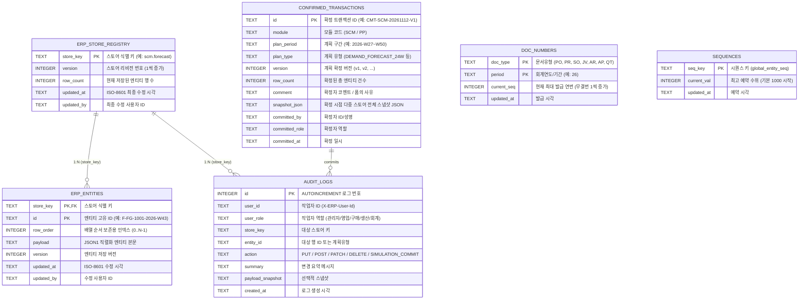

# ERP ERD·데이터모델 v3.1 (SQLite WAL 하이브리드 물리 스키마 & 인메모리 시뮬레이션 구현 기준)

> 최종 갱신: 2026-11-12 | `erp-portal/server/db.mjs`, `dao.mjs` 및 `erp-portal/src/data/mock/*` 기준
> 아키텍처: **Desktop PC 기반 SQLite(WAL) 하이브리드 DB** + **브라우저 인메모리 EntityStore (`useSyncExternalStore`)** 병행 구조

---

## 1. SQLite (WAL Mode) 백엔드 물리 데이터베이스 스키마 (`server/db.mjs`)

155개 도메인 스토어의 고속 스냅샷 처리와 문서번호 채번, 감사 추적(Audit Trail), 시뮬레이션 확정 버전 관리를 위한 **6개의 코어 하이브리드 테이블**과, 기준정보관리(MDM) 12개 도메인을 SQL로 직접 조회·검증할 수 있는 **12개의 정규화 기준정보 물리 테이블(`mdm_*`)** 등 총 **18개 물리 테이블**로 구성된다.

### 1.1 기준정보(MDM) 정규화 물리 테이블 12종 (`mdm_*`)
`dao.mjs`의 `syncMdmPhysicalTable()`을 통해 스토어 쓰기(`PUT/POST/PATCH/DELETE`) 및 초기 시딩(`scripts/seed-db.ts`) 시 `erp_entities`와 동일한 트랜잭션 내에서 12개 정규화 물리 테이블에 자동 양방향 동기화된다 (`GET /api/mdm/status`로 실시간 정합성 검증 가능).

| 물리 테이블명 | 매핑 스토어 키 | 주요 정규화 컬럼 | 초기 시딩 건수 |
|---|---|---|---|
| `mdm_material` | `master.material` | `code(PK)`, `name`, `type`, `uom`, `price`, `stock`, `safety`, `lead_time_weeks`, `lead_time_category`, `status` | 13건 |
| `mdm_bom` | `master.bom` | `id(PK)`, `parent`, `child`, `qty`, `uom`, `loss_rate`, `effective_from` | 16건 |
| `mdm_partner` | `master.partner` | `code(PK)`, `name`, `type`, `country`, `currency`, `pay_term`, `status` | 11건 |
| `mdm_customer` | `sales.customer` | `code(PK)`, `name`, `country`, `currency`, `pay_term`, `grade`, `credit_limit`, `credit_used`, `status` | 6건 |
| `mdm_supplier` | `procurement.vendor-evaluation` | `code(PK)`, `name`, `quality`, `delivery`, `price`, `response`, `grade` | 6건 |
| `mdm_work_center` | `mdm.work_center` | `code(PK)`, `name`, `plant`, `line_type`, `daily_capa`, `shift_hours`, `headcount`, `efficiency_pct`, `status` | 3건 |
| `mdm_warehouse` | `master.warehouse` | `code(PK)`, `name`, `plant`, `type`, `capacity`, `manager`, `status` | 5건 |
| `mdm_plant` | `mdm.plant` | `code(PK)`, `name`, `type`, `country`, `region`, `address`, `manager`, `headcount`, `status` | 5건 |
| `mdm_equipment` | `mdm.equipment` | `code(PK)`, `name`, `line`, `plant`, `maker`, `model`, `install_date`, `pm_cycle_days`, `last_pm`, `mtbf_hours`, `mttr_hours`, `status` | 5건 |
| `mdm_gl_account` | `mdm.gl-account` | `code(PK)`, `name`, `category`, `sub_category`, `normal_side`, `posting`, `budget_control`, `ifs_code`, `status` | 10건 |
| `mdm_fx_rate` | `mdm.fx-rate` | `code(PK)`, `pair`, `base`, `quote`, `rate`, `prev_rate`, `change`, `buy_rate`, `sell_rate`, `plan_rate`, `source`, `updated_at` | 6건 |
| `mdm_org` | `mdm.org` | `code(PK)`, `name`, `level`, `parent`, `head`, `headcount`, `cost_center`, `plant`, `status` | 10건 |



### 물리 DDL 핵심 설정
- `PRAGMA journal_mode = WAL;` (읽기/쓰기 비차단 동시성 확보)
- `PRAGMA synchronous = NORMAL;` (WAL 모드에서 디스크 I/O 최적화 및 무결성 보장)
- `PRAGMA busy_timeout = 5000;` (다중 클라이언트 동시 쓰기 시 5초 대기 큐잉)
- 중첩 트랜잭션 제어: 최외곽 `BEGIN IMMEDIATE ... COMMIT` + 내부 `SAVEPOINT sp_n` (`server/db.mjs`)

---

## 2. Master Entity (기준정보 도메인 스키마)

### Material (품목) — `master.material`
| 필드 | 타입 | 비고 |
|---|---|---|
| `id`, `code` (PK) | string | `FG-`(완제품) / `SF-`(반제품) / `RM-`(원자재) / `PK-`(부자재) |
| `name`, `type` | string | 품목명, 품목구분 |
| `uom`, `price` | string, number | 단위(`EA/KG/M/SET`), 기준단가(구매단가 또는 판매단가) |
| `stock`, `safety` | number | 현재고 / 안전재고 |
| `leadTimeWeeks` | number | **조달 리드타임(주)**: 장납기(6~8주: 배터리셀 8주, BLDC모터 6주), 중납기(2~4주), 단납기(1주) |
| `leadTimeCategory` | string | `"장납기"` \| `"중납기"` \| `"단납기"` (MRP 화요일 입고 역산 기준) |
| `status` | string | `"사용"` \| `"중지"` |

### BOM (다단계 자재명세서) — `master.bom`
| 필드 | 비고 |
|---|---|
| `parent` (FK→Material) | 상위품목 코드 |
| `child` (FK→Material) | 하위 구성품목 코드 |
| `qty`, `uom` | 단위소요량 — **다단계 재귀 구조 (`FG → SF → RM`)** |

### Customer / Partner / Warehouse / VendorEval
- **Customer (`sales.customer`)**: `code(PK)`, `name`, `country`, `currency`, `payTerm`, `grade(A/B/C)`, `creditLimit`, `creditUsed`, `status`
- **Partner (`master.partner`)**: `code(PK)`, `name`, `type(고객/공급사)`, `country`, `currency`, `payTerm`, `status`
- **Warehouse (`master.warehouse`)**: `code(PK)`, `name`, `plant`, `type(완/반/원/부/반품)`, `status`
- **VendorEval (`procurement.vendorEval`)**: `code(PK→Partner)`, `quality`, `delivery`, `price`, `response` (0~100점)

---

## 3. Simulation & Planning Entity (프론트 시뮬레이션 → DB 확정 도메인)

### Forecast (24주 주단위 수요예측) — `scm.forecast`
| 필드 | 타입 | 비고 |
|---|---|---|
| `id` (PK) | string | `F-{material}-{week}` (예: `F-FG-1001-2026-W43`) |
| `material` (FK) | string | 완제품 코드 (`FG-1001`, `FG-1002`, `FG-1003`) |
| `week`, `weekSeq` | string, number | `2026-W27` ~ `2026-W50` (`weekSeq`: 1 ~ 24) |
| `forecast`, `actual` | number | 주간 예측 수량 / 확정 실적 수량 |
| `aiForecast`, `isAi` | number, boolean | **17~24주차 Holt 이중지수평활 + 이동평균 + 선형회귀 앙상블 예측값** |

### ForecastParams (품목별 AI 예측 튜닝 파라미터) — `scm.forecast_params`
- `material(PK)`, `alpha`(수준 평활계수), `beta`(추세 평활계수), `maWindow`(이동평균 구간), `wHoltWinters`, `wMovingAverage`, `wLinearRegression`

### ContingencySim (3~24주 S&OP 비상공급대책 시뮬레이션) — `scm.contingency`
- `id(PK)`, `material`, `week`, `weekSeq(3~24)`, `demand`, `supply`, `projectedStock`, `safetyStock`, `status("안정"|"주의"|"결품위험")`, `contingencyPlan`, `actionOwner`, `costImpact`

### MPS Daily & Weekly (주생산계획) — `production.mps` / `production.mps-weekly`
- **Daily (`production.mps`)**: 1~2주차(14일 일별 버킷), `material`, `date`, `dayOfWeek`, `forecast`, `plan` (일일 라인 CAPA 650 EA 밸런싱)
- **Weekly (`production.mps-weekly`)**: 3~20주차(주간 버킷), `material`, `week`, `weekSeq`, `forecast`, `plan`, `rtfPct`(영업 RTF %), `manHours`(소요 공수), `overtimeHours`(잔업 시간), `outsourcingQty`(외주 물량), `status`

---

## 4. Transaction Entity (일상 실행 트랜잭션 도메인)

- **SalesOrder (`sales.order`)**: `code(PK, SO-YYNNN)`, `customer(FK)`, `orderDate`, `dueDate`, `status(등록→출하예약→출하완료/취소)`, `lines[]: {material, qty, price}`
- **Quotation (`sales.quotation`)**: `code(PK, QT-YYNNN)`, `customer(FK)`, `date`, `validTo`, `status(작성→승인)`, `lines[]`
- **PurchaseRequest (`procurement.pr`)**: `code(PK, PR-YYNNN)`, `dept`, `material(FK)`, `qty`, `amount`, `reqDate`, `dueDate`(MRP 화요일 입고 기준일), `status(승인대기→승인/반려)`
- **PurchaseOrder (`procurement.order`)**: `code(PK, PO-YYNNN)`, `pr(FK)`, `vendor(FK)`, `material(FK)`, `qty`, `price`, `orderDate`, `dueDate`, `status(발주→입고완료)`
- **WorkOrder (`production.work-order`)**: `code(PK, WO-YYNNN)`, `material(FK)`, `qty`, `startDate`, `dueDate`, `status(계획→진행→완료)`, `good`, `defect`
- **Lot (`logistics.lot`)**: `code(PK, LOT-YYMM-SEQ)`, `material(FK)`, `qty`, `wh(FK)`, `vendor(FK)`, `date`, `status(가용/소진/보류)`
- **InventoryTx (`logistics.tx`)**: `type(입고/출고/이동)`, `material`, `qty`, `from`, `to`, `lot(FK)`, `ref(FK→PO/SO/WO)`
- **Inspection (`quality.inspection`)**: `code(PK)`, `lot(FK)`, `material`, `vendor`, `qty`, `sample`, `defects`, `result(대기→합격/불합격)`, `date`
- **Journal (`finance.journal`)**: `code(PK, JV-YYNNN)`, `date`, `desc`, `ref(FK→SO/PO)`, `status(작성→전기)`, `lines[]: {account, dr, cr}` — **차대평형(`Σdr = Σcr`) 서버/클라이언트 이중 검증**
- **AR / AP (`finance.ar` / `finance.ap`)**: `code(PK, AR/AP-YYNNN)`, `ref(FK→SO/PO)`, `customer|vendor(FK)`, `amount`, `invoiceDate`, `dueDate`, `status`

---

## 5. End-to-End 데이터 및 확정 트랜잭션 흐름도

```
[프론트엔드 EntityStore 인메모리 시뮬레이션]
  1) 고객사 24주 구매계획 CSV 업로드 + 17~24주 Holt AI 통계예측 (scm.forecast)
  2) S&OP 3~24주 결품위험 감지 및 Contingency 대책 시뮬레이션 (scm.contingency)
  3) 14일 일별 + 20주 주간 MPS 라인 CAPA/인력/외주 밸런싱 (production.mps / mps-weekly)
  4) 24주 화요일 입고 기준 리드타임(1~8주) 역산 MRP 전개 ──▶ [📌 계획 확정 (Commit)]
                                                                 │
                                     POST /api/simulation/commit ▼
[Desktop PC SQLite(WAL) DB 원자적 영속화]
  ├─ erp_entities / erp_store_registry 일괄 갱신 (BEGIN IMMEDIATE ... COMMIT)
  ├─ confirmed_transactions 버전(v1, v2...) 및 전체 스냅샷 아카이빙
  └─ audit_logs 감사 추적 이력 기록
                                                                 │
                                                                 ▼
[실행 트랜잭션 연계]
  MRP 부족분 원클릭 PR 발행(PR-26XXX) ─승인→ PO 발주 ─입고→ LOT 생성 + 수입검사(QM)
  → 작업지시(WO) 생산실행/백플러시 → 수주(SO) 출고(FIFO) → 매출전표(JV)/채권(AR) → EIS 손익/KPI
```
